 

I build AI systems that move beyond conversation agents with memory, tools and the judgment to stop at the right boundary.

<code>LOCAL INTELLIGENCE</code>   ✦   <code>MCP INFRASTRUCTURE</code>   ✦   <code>GOVERNED AUTONOMY</code>

 

<h2 align="center">✦ SYSTEMS IN ORBIT ✦</h2>

SIX BUILDS · ONE OPERATING PHILOSOPHY

  

  <a href="https://github.com/kamikaze1120/r2d2-ai-agent">R2D2 AI AGENT</a>
  &nbsp; ◆ &nbsp;
  <a href="https://github.com/kamikaze1120/CLI-MCP">CLI-MCP</a>
  &nbsp; ◆ &nbsp;
  <a href="https://github.com/kamikaze1120/RTAIP">RTAIP</a>
  &nbsp; ◆ &nbsp;
  <a href="https://github.com/kamikaze1120/salesforce-delivery-agent">SALESFORCE DELIVERY</a>
  &nbsp; ◆ &nbsp;
  <a href="https://github.com/kamikaze1120/skyshift">SKYSHIFT</a>
  &nbsp; ◆ &nbsp;
  <a href="https://github.com/kamikaze1120/business-doc-analyzer">DOC ANALYZER</a>

 

<h2 align="center">◈ BUILD FREQUENCY ◈</h2>

THE TECHNOLOGIES BEHIND THE SIGNAL

  

  

 

 

 

  

<code>◉ TRANSMISSION ACTIVE // NAVY 03 // GILDED ORBIT</code>

