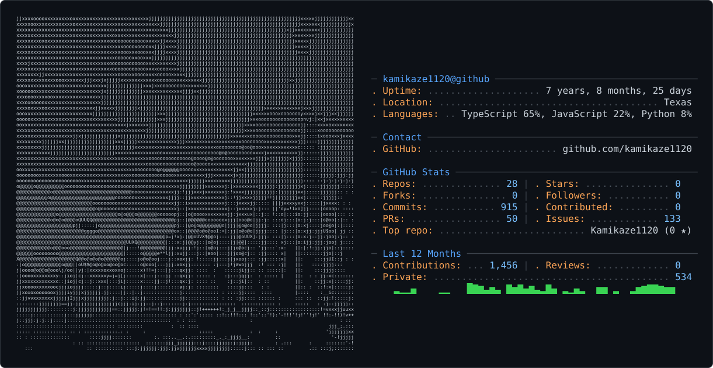

  
  
  

<picture>
  <source media="(prefers-color-scheme: dark)" srcset="dark_mode.svg">
  
</picture>
SYSTEM ONLINE  //  SIGNAL LOCKED  //  BUILD SURFACE ACTIVE
~/mission
I build local-first AI systems that move beyond chat—agents that can reason over business context, invoke real tools through MCP, retain useful memory, and execute inside explicit approval boundaries.

The through-line is simple: useful autonomy without surrendering control.
<table>
  <tr>
    <td align="center" width="33%">
      <h3>◈ Agent Systems</h3>
      Local models, memory, voice and multi-step execution.
    </td>
    <td align="center" width="33%">
      <h3>⌁ Tool Infrastructure</h3>
      MCP gateways, isolated runtimes and governed actions.
    </td>
    <td align="center" width="33%">
      <h3>◎ Intelligence Interfaces</h3>
      Geospatial, scientific and operational data made explorable.
    </td>
  </tr>
</table>~/selected-systems
<table>
  <tr>
    <td width="50%" valign="top">
      <h3><a href="https://github.com/kamikaze1120/r2d2-ai-agent">R2D2 AI Agent</a></h3>
      
A local AI butler and autonomous business engine with on-device inference, persistent memory and a voice interface.

      
<code>Python</code> <code>React</code> <code>Ollama</code> <code>ElevenLabs</code> <code>Supabase</code>

    </td>
    <td width="50%" valign="top">
      <h3><a href="https://github.com/kamikaze1120/CLI-MCP">CLI-MCP</a></h3>
      
An MCP gateway that gives AI clients controlled access to 50+ command-line tools inside an isolated Docker environment.

      
<code>Python</code> <code>FastMCP</code> <code>Docker</code> <code>MCP</code>

    </td>
  </tr>
  <tr>
    <td width="50%" valign="top">
      <h3><a href="https://github.com/kamikaze1120/RTAIP">RTAIP</a></h3>
      
A geospatial intelligence workspace that fuses public-source intelligence and open geodata into one operational view.

      
<code>TypeScript</code> <code>Maps</code> <code>OSINT</code> <code>Data Fusion</code>

    </td>
    <td width="50%" valign="top">
      <h3><a href="https://github.com/kamikaze1120/salesforce-delivery-agent">Salesforce Delivery Agent</a></h3>
      
A governed delivery pipeline that carries requirements from BRD through Jira, architecture review, testing, CI/CD and approval gates.

      
<code>JavaScript</code> <code>Salesforce</code> <code>GitHub Actions</code> <code>SDLC</code>

    </td>
  </tr>
  <tr>
    <td width="50%" valign="top">
      <h3><a href="https://github.com/kamikaze1120/skyshift">Skyshift</a></h3>
      
A NASA Space Apps build that turns SPHEREx observations into an explorable time sequence for spotting motion and change across the sky.

      
<code>TypeScript</code> <code>SPHEREx</code> <code>Scientific Data</code> <code>Vercel</code>

    </td>
    <td width="50%" valign="top">
      <h3><a href="https://github.com/kamikaze1120/business-doc-analyzer">Business Document Analyzer</a></h3>
      
An AI-assisted workspace for extracting, analyzing and generating structured business documentation.

      
<code>JavaScript</code> <code>LLMs</code> <code>Document Intelligence</code>

    </td>
  </tr>
</table>~/engineering-principles
Principle	What it means in practice
Local by default	Keep models, context and sensitive workflows on the user's machine whenever possible.
Tools over theater	Give agents useful capabilities—not just a convincing chat interface.
Guardrails are architecture	Scope permissions, isolate execution and require approval at consequential boundaries.
Trace every action	Make tool calls, data sources and state transitions inspectable.
Ship the whole loop	Build from interface to runtime to deployment, not isolated demos.

~/stack
Layer	Technologies
Languages	TypeScript · JavaScript · Python · Dart
Interfaces	React · Next.js · Flutter · Tailwind CSS
Agent Runtime	Ollama · FastAPI · MCP · tool-calling workflows
Data & State	Supabase · Firebase · geospatial and scientific datasets
Infrastructure	Docker · Vercel · GitHub Actions · Git

~/current-transmission
focus:
  - trustworthy agent execution
  - MCP-native tooling
  - local inference and durable memory
  - scientific and geospatial interfaces

building_for:
  - operators who need leverage
  - teams that need governance
  - curious people exploring complex data
~/activity

<code>[ DIGITAL KOI // FEEDING ON COMMITS ]</code>

