 

  
  
  
  

<code>◉ ONLINE</code>   <code>LOCAL-FIRST</code>   <code>MCP-NATIVE</code>   <code>HUMAN-GOVERNED</code>

 

◈ Mission Control

I engineer AI systems that can observe, reason and act—without turning control over to a black box.

My work sits where local inference, persistent memory, real-world tools and governed automation meet. I build agents that operate on your machine, connect through MCP, expose what they are doing and stop at the boundaries that matter.

<table>
  <tr>
    <td width="33%" align="center" valign="top">
      <h3>◉ AGENT CORE</h3>
      
Local models Durable memory Voice interfaces Multi-step reasoning

    </td>
    <td width="33%" align="center" valign="top">
      <h3>⌬ TOOL MESH</h3>
      
MCP gateways CLI execution Isolated runtimes Operational workflows

    </td>
    <td width="33%" align="center" valign="top">
      <h3>◇ CONTROL LAYER</h3>
      
Scoped permissions Approval gates Observable actions Human override

    </td>
  </tr>
</table>

PRIMARY_DIRECTIVE:
  build: useful autonomy
  preserve: human control
  default: local execution
  interface: tools, not theater

✦ System Constellation

<strong>ACCESS SYSTEM MANIFEST</strong>

System

Mission

Core signal

R2D2 AI Agent

Local AI butler and autonomous business engine

Ollama · voice · persistent memory

CLI-MCP

Controlled MCP access to 50+ CLI tools

FastMCP · Docker · isolation

RTAIP

Public-source geospatial intelligence fusion

TypeScript · maps · OSINT

Salesforce Delivery Agent

Governed BRD-to-deployment workflow

Salesforce · CI/CD · approval gates

Skyshift

SPHEREx sky-change explorer for NASA Space Apps

scientific data · time sequences · Vercel

Business Document Analyzer

AI-assisted document analysis and generation

JavaScript · LLMs · structured output

⌬ Technology Array

  

 

SIGNAL LAYER

ACTIVE TECHNOLOGIES

LANGUAGES

TypeScript · JavaScript · Python · Dart

INTELLIGENCE

Ollama · LLM orchestration · tool calling · memory

INTERFACES

React · Next.js · Flutter · Tailwind CSS

DATA

Supabase · Firebase · geospatial · scientific datasets

OPERATIONS

Docker · Vercel · GitHub Actions · Git

◉ Operating Protocol

[01] LOCAL BY DEFAULT       Keep models, context and sensitive workflows close.
[02] TOOLS OVER THEATER     Build capability—not merely a convincing chat window.
[03] GUARDRAILS BY DESIGN   Scope access and stop at consequential boundaries.
[04] TRACE EVERY ACTION     Make sources, calls and state transitions inspectable.
[05] SHIP THE WHOLE LOOP    Connect interface, runtime, data and deployment.

✧ Deep-Space Telemetry

  

<picture>
  <source media="(prefers-color-scheme: dark)" srcset="https://raw.githubusercontent.com/kamikaze1120/Kamikaze1120/main/dark_mode.svg">
  
</picture>

 

◇ Anomaly Bay

 

 

  

<code>END OF TRANSMISSION // THE SIGNAL CONTINUES</code>

