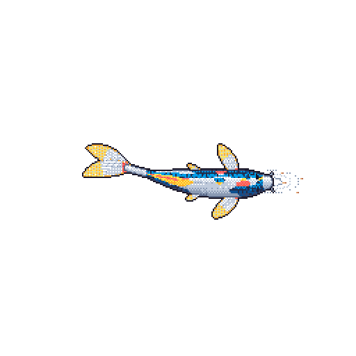

<div align="center">
<picture>
  <source media="(prefers-color-scheme: dark)" srcset="dark_mode.svg" />
  <source media="(prefers-color-scheme: light)" srcset="light_mode.svg" />
  
</picture>
```diff
+ > SYSTEM ONLINE // SIGNAL DETECTED
+ > BUILDING IN THE SHADOWS...
+ > ANOMALY FOUND: DIGITAL KOI [ACTIVE]
```



<sub><code>[ FEEDING ON COMMITS ]</code></sub>

</div>
